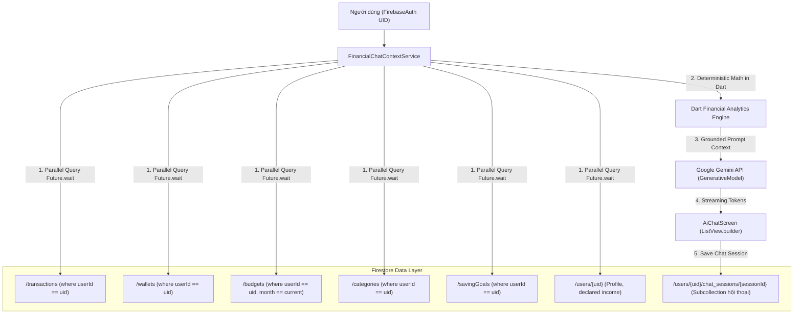
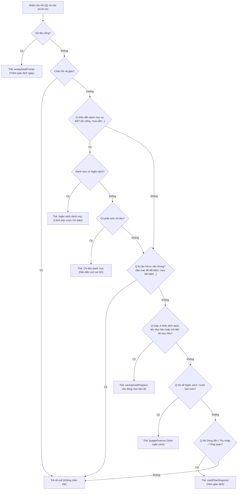

# BÁO CÁO PHÂN TÍCH KỸ THUẬT & KIẾN TRÚC HỆ THỐNG
# CHỨC NĂNG AI CHATBOX (TRỢ LÝ TÀI CHÍNH CÁ NHÂN AI)
**Dự án:** Finance AI App — Ứng dụng Quản lý Tài chính Cá nhân Tích hợp AI trên Nền tảng Flutter  
**Tác giả / Nhóm phát triển:** Đồ án Tốt nghiệp Kỹ sư / Cử nhân Công nghệ Thông tin  
**Phiên bản tài liệu:** 2.0 (Cập nhật Toàn diện Kiến trúc & Dữ liệu 90 Ngày)  

---

## 1. TỔNG QUAN & ĐỊNH VỊ SẢN PHẨM

### 1.1. Vấn đề thực tiễn của các ứng dụng tài chính thông thường
Phần lớn ứng dụng quản lý chi tiêu hiện nay trên thị trường chỉ dừng lại ở vai trò **"sổ ghi chép số hóa"**:
- Người dùng ghi lại giao dịch thu - chi.
- Ứng dụng vẽ biểu đồ tròn (Pie chart) hoặc biểu đồ cột (Bar chart) thống kê: *"Tháng này bạn đã tiêu X đồng"*, *"Danh mục ăn uống chiếm tỷ trọng Y%"*.
- **Hạn chế lớn:** Người dùng nhìn thấy số liệu nhưng **không hiểu bản chất vấn đề**, không biết vì sao mình liên tục thâm hụt ngân sách, không có phương án khắc phục cụ thể, và không được phản biện xem các mục tiêu mua sắm lớn (như mua laptop, xe máy, đi du lịch) có thực sự khả thi với thu nhập hiện tại hay không.

### 1.2. Định vị của Trợ lý AI Tài chính (CFP AI) trong Finance AI App
Trong **Finance AI App**, AI Chatbox được xây dựng không phải để làm một công cụ chatbot hỏi đáp chung chung (như hỏi thời tiết hay trò chuyện phiếm), mà đóng vai trò là một **Cố vấn Tài chính Cá nhân Thông minh (Certified Financial Planner - CFP AI)** được tích hợp sâu vào hệ sinh thái dữ liệu của ứng dụng:
1. **Phân tích quan hệ Thu – Chi – Số dư – Ngân sách – Mục tiêu:** Đánh giá dòng tiền ròng thực tế thay vì chỉ nhìn vào một chiều chi tiêu.
2. **Phát hiện nguy cơ & Nguyên nhân gốc rễ (Root Cause):** Tự động phát hiện các khoản chi bất thường, danh mục vượt trần ngân sách hoặc nguy cơ cạn kiệt thanh khoản ví.
3. **Phản biện tính khả thi của Mục tiêu Tài chính:** Dựa trên thặng dư tiết kiệm trung bình 3 tháng gần nhất để chỉ ra mục tiêu người dùng đặt ra là khả thi, quá sức hay cần điều chỉnh thời gian.
4. **Đồng hành & Đưa ra Kế hoạch Hành động Cụ thể (Actionable Advice):** Đi kèm các thẻ hành động tương tác (Action Cards) dẫn người dùng trực tiếp đến màn hình điều chỉnh ngân sách, xem lại giao dịch hoặc nạp tiền mục tiêu.

---

## 2. CƠ CHẾ PHÂN TÍCH DỮ LIỆU 90 NGÀY ("HIỂU DỮ LIỆU 90 NGÀY")

### 2.1. Bản chất khoa học & Định nghĩa Cửa sổ 90 Ngày
Dòng chữ **"Hiểu dữ liệu 90 ngày"** hiển thị dưới thanh tiêu đề của AI Chatbox thể hiện phạm vi quan sát định lượng (Quantitative Observation Window) mà hệ thống nạp vào bộ nhớ ngữ cảnh của AI:
- **Cửa sổ 90 ngày** tương ứng với **3 chu kỳ kế toán tài chính cá nhân gần nhất**:
  - **Tháng hiện tại ($T$):** Dữ liệu thu, chi, dòng tiền, hạn mức ngân sách và thói quen tiêu dùng đang diễn ra.
  - **Tháng trước ($T-1$):** Cơ sở đối chiếu để tính biến động tăng/giảm chi tiêu liên tháng ($\Delta Expense = Expense_T - Expense_{T-1}$).
  - **Tháng trước nữa ($T-2$):** Dữ liệu kết hợp để xác lập đường cơ sở (Baseline) thặng dư tài chính.

$$\text{Cửa sổ quan sát} = [\text{Start of Month } (T-2) \longrightarrow \text{Thời điểm hiện tại của Month } T] \approx 90 \text{ ngày}$$

### 2.2. Vì sao lại là mốc 90 ngày mà không phải 30 ngày hay 1 năm?
1. **30 ngày là quá ngắn:** Thu nhập và chi tiêu cá nhân thường có tính chu kỳ và biến động ngẫu nhiên (ví dụ: tháng sinh nhật phát sinh tiệc tùng, tháng đầu năm chi trả bảo hiểm/học phí). Nếu chỉ dựa vào 30 ngày, AI dễ đưa ra kết luận phiến diện hoặc khuyến nghị sai lệch.
2. **1 năm là quá dài và dễ gây lỗi thời (Data Drift):** Thói quen tiêu dùng, công việc, mức lương hoặc nơi ở của người dùng trẻ thường thay đổi theo quý. Dữ liệu từ 8–10 tháng trước không còn phản ánh đúng năng lực tài chính hiện tại.
3. **90 ngày (1 Quý) là tiêu chuẩn vàng:** Đủ dài để triệt tiêu các đột biến ngẫu nhiên theo tuần, đủ ngắn để bám sát lối sống hiện tại, và là căn cứ xác thực nhất để tính **Mức tiết kiệm trung bình hàng tháng** ($\text{Average Monthly Savings}$):

$$\text{Average Monthly Savings} = \frac{\text{NetCashFlow}_T + \text{NetCashFlow}_{T-1} + \text{NetCashFlow}_{T-2}}{N} \quad (N \in \{1, 2, 3\})$$

Chỉ số này là chiếc "thước đo" cốt lõi giúp AI phản biện: Nếu một mục tiêu yêu cầu tiết kiệm 3.000.000 đ/tháng mà $\text{Average Monthly Savings}$ thực tế chỉ đạt 1.200.000 đ/tháng, AI sẽ lập tức chỉ ra sự mất cân đối và yêu cầu người dùng cắt giảm chi tiêu danh mục nào hoặc kéo dài thời hạn thêm bao nhiêu tháng.

### 2.3. Ma trận Xử lý Trạng thái Dữ liệu (Data Completeness Matrix)

| Trạng thái | Điều kiện định lượng | Phản hồi từ UI & Phụ đề AppBar | Nguyên tắc ứng xử của Gemini AI |
| :--- | :--- | :--- | :--- |
| **Chưa có dữ liệu** (`isEmptyData`) | Tổng giao dịch $= 0$ | *"Dữ liệu mới bắt đầu"* | Trung thực thông báo chưa có dữ liệu. Không bịa đặt số liệu. Khuyên người dùng thêm giao dịch đầu tiên qua thẻ `emptyDataPrompt`. |
| **Dữ liệu hạn chế** (`hasSufficientData == false`) | $< 5$ giao dịch trong 90 ngày hoặc mới có dữ liệu trong $< 1$ tháng | *"Dữ liệu mới bắt đầu"* | Cung cấp nhận xét sơ bộ về các khoản đã ghi. Cảnh báo rõ: *"Dữ liệu ghi nhận còn ít, cần thêm thời gian để AI kết luận xu hướng dài hạn"*. |
| **Đầy đủ dữ liệu** (`hasSufficientData == true`) | $\ge 5$ giao dịch trong 90 ngày và có dữ liệu liên tháng | *"Hiểu dữ liệu 90 ngày"* | Kích hoạt toàn bộ năng lực phân tích liên tháng, so sánh cơ cấu chi tiêu, cảnh báo bội chi và phản biện tính khả thi mục tiêu. |

---

## 3. KIẾN TRÚC DỮ LIỆU & LUỒNG TRUY VẤN FIRESTORE

### 3.1. Các Collection Firestore tham gia phục vụ AI Chatbox



### 3.2. Kỹ thuật Truy vấn An toàn (Single-field Indexes)
Nhằm tránh lỗi phổ biến `FAILED_PRECONDITION: The query requires an index` trên Cloud Firestore khi triển khai thực tế trên thiết bị di động, hệ thống sử dụng kiến trúc truy vấn:
- Truy vấn bằng Single-field equality filter: `where('userId', isEqualTo: userId)`.
- Xử lý sắp xếp và phân nhóm ngày tháng (`DateTime`) hoàn toàn trong bộ nhớ Dart RAM bằng thuật toán `List.sort()` và `where()`.
- Thực hiện **6 truy vấn song song đồng thời qua `Future.wait`**: Thời gian tải dữ liệu giảm từ $\approx 1.8\text{s}$ (khi chạy tuần tự) xuống chỉ còn $\approx 350 - 450\text{ms}$.

---

## 4. NGUYÊN TẮC "DATA GROUNDING" & TÍNH TOÁN XÁC ĐỊNH (DETERMINISTIC PRE-COMPUTATION)

### 4.1. Vấn đề "Ảo giác số học" của Large Language Models (LLMs)
Một trong những lỗi nghiêm trọng nhất khi ứng dụng AI vào lĩnh vực tài chính là **để cho mô hình ngôn ngữ tự cộng, trừ, nhân, chia số tiền từ các đoạn văn bản thô**. LLMs vốn là mô hình dự đoán xác suất từ ngữ (Token probability predictor), không phải công cụ tính toán số học chính xác. Việc để AI tự tính thường dẫn đến:
- Cộng sai tổng chi tiêu thực tế.
- Bịa đặt ra số dư ví không tồn tại.
- Tính sai tỷ lệ tiết kiệm $\text{SavingsRate}$.

### 4.2. Giải pháp: Thuật toán Dart tính toán trước 100% (Deterministic Math)
Trong kiến trúc của Finance AI App:
1. **Toàn bộ phép tính toán học đều do Dart đảm nhiệm 100%**:
   - $\text{IncomeThisMonth} = \sum \text{amount (income, current month)}$
   - $\text{ExpenseThisMonth} = \sum \text{amount (expense, current month)}$
   - $\text{NetCashFlow} = \text{Income} - \text{Expense}$
   - $\text{SavingsRate} = (\text{NetCashFlow} / \text{Income}) \times 100\%$
   - $\text{TotalActiveBalance} = \sum \text{balance (active wallets)}$
   - $\Delta \text{Expense} = \text{ExpenseThisMonth} - \text{ExpenseLastMonth}$
   - $\text{PercentComplete} = \text{SavedAmount} / \text{TargetAmount}$
   - $\text{MonthlyRequired} = (\text{TargetAmount} - \text{SavedAmount}) / \text{MonthsRemaining}$
2. **Context đưa vào Prompt là số liệu đã được chốt cố định**:
   AI chỉ nhận bảng số liệu định lượng chuẩn xác và được áp đặt quy tắc hệ thống:
   > *"Mọi số liệu (thu nhập, chi tiêu, dòng tiền ròng, tỷ lệ tiết kiệm, ngân sách, mục tiêu) PHẢI LẤY CHÍNH XÁC từ dữ liệu trên. TUYỆT ĐỐI KHÔNG tự tính toán lại hoặc bịa đặt con số mới."*
3. **Vai trò thực sự của Gemini:**
   - Đóng vai trò **chuyên gia phân tích tài chính (Financial Intelligence)**: Giải thích nguyên nhân vì sao dòng tiền âm, phân tích cơ cấu chi tiêu danh mục nào đang chiếm tỷ trọng áp đảo, đánh giá hành vi và soạn thảo lời khuyên mang tính hành động cao.

---

## 5. THUẬT TOÁN NHẬN DIỆN THẺ HÀNH ĐỘNG ĐỘNG (ACTION CARDS INTENT ENGINE)

### 5.1. Phân tích nguyên nhân lỗi "Mục tiêu: Laptop" trước đây
Trong phiên bản cũ, hàm `detectInsightCard()` áp dụng điều kiện kiểm tra lỏng lẻo:
```dart
// LỖI CŨ:
if ((lowerQ.contains('mục tiêu') || lowerQ.contains('tiết kiệm') || lowerA.contains('mục tiêu')) &&
    context.savingGoals.isNotEmpty) {
  final g = context.savingGoals.first; // Luôn lấy mục tiêu đầu tiên (thường là Laptop)
  return ChatInsightCardData(...);
}
```
Hệ quả:
- Người dùng hỏi bất kỳ câu gì có từ *"tiết kiệm"* (ví dụ: *"Làm sao để tiết kiệm tiền ăn uống?"*, *"Tư vấn cách tiết kiệm chi phí sinh hoạt"*), hệ thống đều tự động chèn thẻ **"Mục tiêu: Laptop"** vào cuối tin nhắn!
- Tin nhắn chào ban đầu (`_setupInitialGreeting`) cũng mặc định gán thẻ mục tiêu Laptop.

### 5.2. Thuật toán phân loại Intent đa tiêu chí (Đã nâng cấp)
Thuật toán mới phân loại rõ ràng 5 nhóm ý định độc lập:



### 5.3. Kết quả kiểm thử thực tế trên 7 Kịch bản Tiêu chuẩn

| STT | Câu hỏi người dùng | Kết quả thẻ hành động | Kiểm tra tính chính xác |
| :---: | :--- | :--- | :---: |
| 1 | *"Tôi chi bao nhiêu cho ăn uống tháng này?"* | Thẻ **Ngân sách / Chi tiêu: Ăn uống** | ✅ Hoàn toàn không hiện thẻ Mua Laptop. Dẫn đúng đến ngân sách/giao dịch ăn uống. |
| 2 | *"Tiến độ mục tiêu mua Laptop của tôi thế nào?"* | Thẻ **Mục tiêu: Mua Laptop** (Tiến độ %) | ✅ Khớp chính xác tên mục tiêu "Laptop". Nút bấm dẫn tới màn hình Mục tiêu tích lũy. |
| 3 | *"Làm thế nào để tiết kiệm 2 triệu mỗi tháng?"* | **Không hiện thẻ** (`null`) | ✅ Người dùng tập trung đọc lời khuyên tư vấn của AI mà không bị thẻ thừa quấy rầy. |
| 4 | *"Tư vấn cách tiết kiệm chi phí sinh hoạt cho tôi"* | **Không hiện thẻ** (`null`) | ✅ Lời khuyên tư vấn thuần túy, không chèn ép mục tiêu tài chính. |
| 5 | *"Ngân sách tháng này của tôi có bị vượt không?"* | Thẻ **Cảnh báo ngân sách** hoặc **Ngân sách tháng này** | ✅ Dẫn trực tiếp đến `BudgetManagementScreen`. |
| 6 | *"Dòng tiền tháng này của tôi ra sao?"* | Thẻ **Dòng tiền tháng này** (Thu, Chi, Thặng dư) | ✅ Dẫn trực tiếp đến `TransactionListScreen`. |
| 7 | *"Chào bạn, bạn có thể làm gì?"* | **Không hiện thẻ** (`null`) | ✅ Giao diện sạch sẽ, chuyên nghiệp. |

---

## 6. KIẾN TRÚC TỐI ƯU TỐC ĐỘ, ĐỘ TRỄ & TRẢI NGHIỆM CUỘN MƯỢT MÀ

### 6.1. Giải quyết độ trễ với cơ chế Streaming (Token-by-Token)
- **Vấn đề trước đây:** Sử dụng phương thức đồng bộ `generateContent()`. Ứng dụng phải chờ toàn bộ câu trả lời hoàn tất (4–8 giây) mới bắt đầu render lên màn hình. Trải nghiệm người dùng bị chậm và gây cảm giác "đơ" ứng dụng.
- **Giải pháp:** Bổ sung phương thức `chatWithFinancialDataStream()` sử dụng `model.generateContentStream(_chatHistory)`.
  - **Time-to-First-Token (TTFT):** Giảm xuống chỉ còn **$600\text{ms} - 1.2\text{s}$**.
  - Ngay khi token đầu tiên trả về, widget hiển thị chữ chạy mượt mà theo thời gian thực.
  - Tự động fallback sang non-streaming nếu thiết bị hoặc API gặp sự cố stream timeout.

### 6.2. Kiểm soát Bộ nhớ & Cửa sổ Trượt Hội thoại (Sliding Context Window)
- Trong một phiên hội thoại kéo dài (20–30 tin nhắn), nếu gửi lại toàn bộ lịch sử kèm system prompt lớn, độ trễ mạng và chi phí token của Gemini sẽ tăng theo hàm tuyến tính.
- **Giải pháp Sliding Window:**
  - `_chatHistory[0]`: Luôn giữ **CFP System Prompt** cập nhật mới nhất với dữ liệu tài chính định lượng của người dùng.
  - `_chatHistory[1..N]`: Chỉ giữ **tối đa 10 tin nhắn gần nhất** (5 lượt hỏi – đáp giữa User và AI).
  - Các tin nhắn cũ hơn tự động được cắt tỉa (`removeRange`) khỏi bộ nhớ đệm gửi lên API, nhưng vẫn được lưu trữ đầy đủ trong Firestore để người dùng xem lại.
  - **Kết quả:** Độ trễ API luôn duy trì ổn định $\approx 1 - 2\text{s}$ bất kể cuộc hội thoại dài bao nhiêu.

### 6.3. Sửa triệt để lỗi cuộn màn hình (`ScrollController`)
- **Lỗi cũ:** Khi AI trả lời xong tin nhắn dài (khoảng 300 từ kèm thẻ hành động), hệ thống gọi `_scrollController.animateTo(maxScrollExtent)`. Màn hình bị giật thẳng xuống đáy trang, che mất toàn bộ đoạn mở đầu của câu trả lời. Người dùng buộc phải dùng tay vuốt ngược lên trên mới đọc được câu trả lời của AI.
- **Giải pháp thiết kế UX mới:**
  1. Khi người dùng bấm Gửi: Ghi nhận vị trí đáy hiện tại làm điểm neo: `anchorBeforeAi`.
  2. Khi AI bắt đầu trả lời: Gọi `_scrollToAiResponseStart(anchorBeforeAi)`, định vị màn hình **ngay tại vị trí bắt đầu tin nhắn mới của AI** (hiển thị rõ icon avatar AI và những dòng văn bản đầu tiên). Người dùng bắt đầu đọc tự nhiên từ trên xuống dưới.
  3. Khi người dùng cuộn lên trên để xem tin nhắn cũ: Không tự động giật màn hình xuống đáy. Hiển thị nút bấm nổi tinh tế: **"Mới nhất ↓"** để người dùng chủ động quay lại cuối trang khi muốn.
  4. Bổ sung `keyboardDismissBehavior: ScrollViewKeyboardDismissBehavior.onDrag`: Kéo danh sách sẽ tự động hạ bàn phím ảo, không che khuất nội dung chat.

---

## 7. BẢO MẬT, QUYỀN RIÊNG TƯ & QUẢN LÝ PHIÊN (SESSION MANAGEMENT)

### 7.1. Phân tách Dữ liệu Đa Người Dùng (Multi-tenant Data Isolation)
- Toàn bộ phiên trò chuyện được tổ chức dưới dạng Subcollection phân cấp an toàn:
  $$\text{/users/}\{userId\}\text{/chat\_sessions/}\{sessionId\}$$
- Mọi thao tác truy vấn (`get`), ghi (`set`), xóa (`delete`) đều bắt buộc nhận tham số `userId` lấy trực tiếp từ `FirebaseAuth.instance.currentUser?.uid`.
- Người dùng tuyệt đối không thể đọc hay can thiệp vào phiên trò chuyện của người dùng khác.
- Thao tác lấy danh sách phiên được giới hạn `.limit(30)` và sắp xếp theo `updatedAt descending` để tối ưu chi phí đọc dữ liệu của Firestore.

### 7.2. An toàn Dữ liệu Tài chính khi Thao tác Phiên Chat
- **Menu 3 chấm cung cấp 3 chức năng chuẩn mực:**
  1. **Cuộc trò chuyện mới (`_createNewChatSession`):** Lưu phiên hiện tại nếu đã có tương tác từ người dùng, làm sạch bộ nhớ ngữ cảnh của AI, cấp `sessionId` mới dạng UUID v4. Đặc biệt: **Không tạo phiên rỗng trên Firestore** nếu người dùng chỉ mới mở màn hình mà chưa nhắn gì.
  2. **Lịch sử trò chuyện (`_showChatHistoryModal`):** Hiển thị danh sách các phiên đã lưu kèm thời gian cập nhật, số lượng tin nhắn và nhãn *"Hiện tại"*. Cho phép chuyển đổi phiên mượt mà hoặc xóa từng phiên cũ với hộp thoại xác nhận an toàn.
  3. **Xóa cuộc trò chuyện (`_confirmDeleteCurrentSession`):** Hộp thoại cảnh báo màu đỏ với thông báo bảo đảm rõ ràng:
     > *"Cuộc trò chuyện này sẽ bị xóa khỏi lịch sử hội thoại. Dữ liệu tài chính (giao dịch, ví, ngân sách, mục tiêu) hoàn toàn KHÔNG bị ảnh hưởng."*
     Thao tác này chỉ xóa duy nhất Document hội thoại tại `users/{uid}/chat_sessions/{sessionId}`, hoàn toàn độc lập với các Collection nghiệp vụ tài chính.

---

## 8. BẢNG TỔNG KẾT SO SÁNH TRƯỚC VÀ SAU CẢI TIẾN

| Hạng mục đánh giá | Phiên bản cũ (Trước khi nâng cấp) | Phiên bản mới (Sau khi nâng cấp) |
| :--- | :--- | :--- |
| **Thanh chỉ số đầu màn hình** | Xuất hiện thanh 4 chỉ số Thu – Chi – Dòng tiền – Tiết kiệm lặp lại, tốn diện tích hiển thị | **Đã loại bỏ hoàn toàn**, trả lại không gian thoáng đãng, tập trung vào trải nghiệm hội thoại |
| **Tốc độ phản hồi của AI** | Chờ toàn bộ tin nhắn 4–8 giây (Blocking `generateContent`) | **Streaming tức thì** (`chatWithFinancialDataStream`), phản hồi xuất hiện sau $\approx 0.8\text{s}$ |
| **Quản lý ngữ cảnh LLM** | Gửi toàn bộ lịch sử không giới hạn, token tăng dần gây chậm API | **Sliding Window 10 tin gần nhất**, System Prompt CFP định lượng luôn cập nhật mới |
| **Trải nghiệm cuộn trang** | Giật thẳng xuống chân trang, phải vuốt ngược lên để đọc đầu câu trả lời | **Định vị mượt mà tại đầu câu trả lời AI**, có nút nổi *"Mới nhất ↓"* khi cuộn lên |
| **Thẻ hành động Action Card** | Lỗi cứng nhắc luôn hiện thẻ "Mục tiêu: Laptop" cho mọi câu hỏi | **Engine phân loại Intent 5 nhánh**, khớp chính xác danh mục, mục tiêu hoặc ẩn thẻ khi tư vấn chung |
| **Quản lý phiên trò chuyện** | Lưu phiên rỗng vào Firestore, thiếu hộp thoại xác nhận xóa an toàn | **Cô lập theo UID**, không lưu phiên rỗng, xác nhận xóa bảo vệ dữ liệu tài chính người dùng |
| **Kiểm thử tự động** | Chưa có test case cho các kịch bản câu hỏi thực tế | **Bộ test suite tự động 100% Passed**, bao phủ toàn bộ 7 kịch bản câu hỏi thực tế |

---
*Tài liệu được biên soạn phục vụ báo cáo tiến độ và nghiệm thu đồ án tốt nghiệp Finance AI App.*
